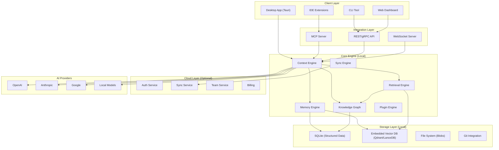
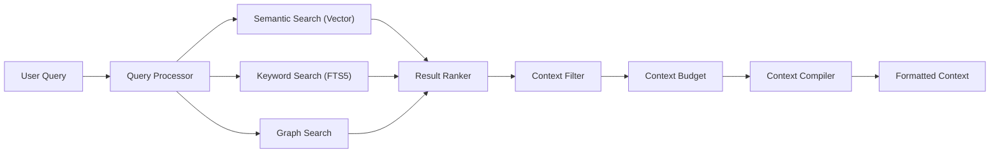
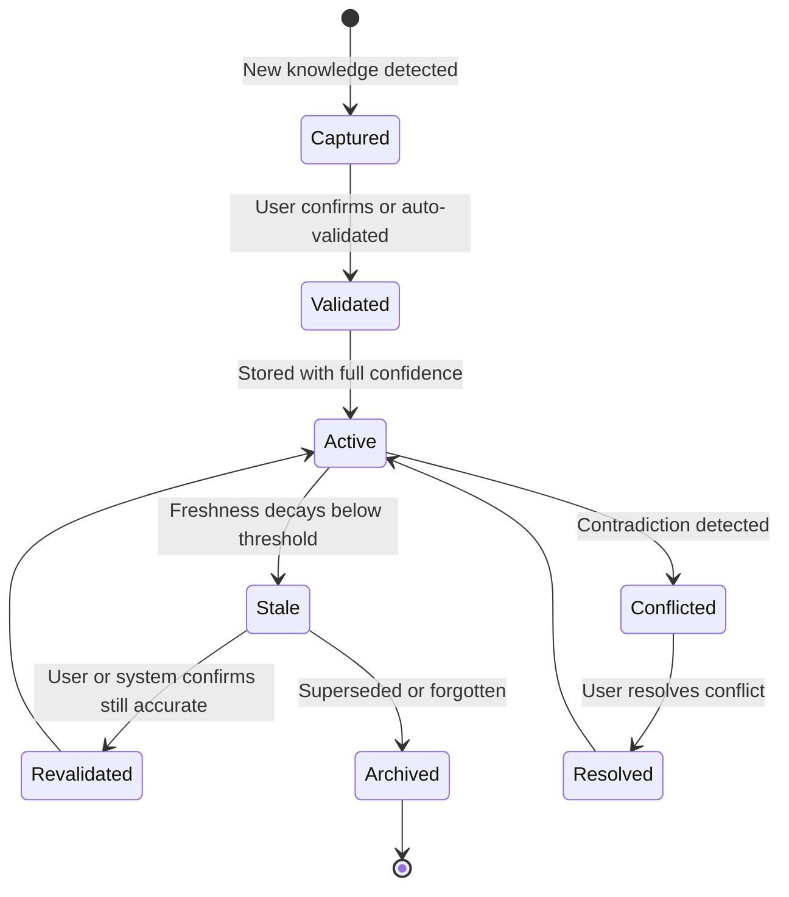
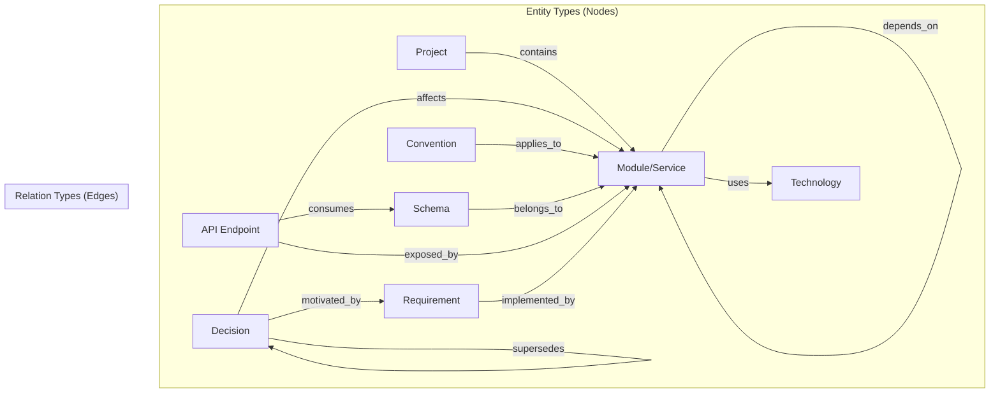
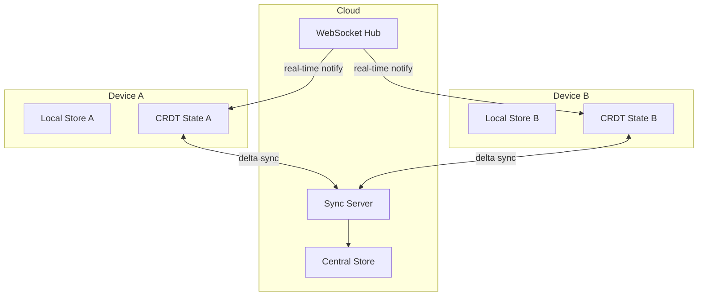
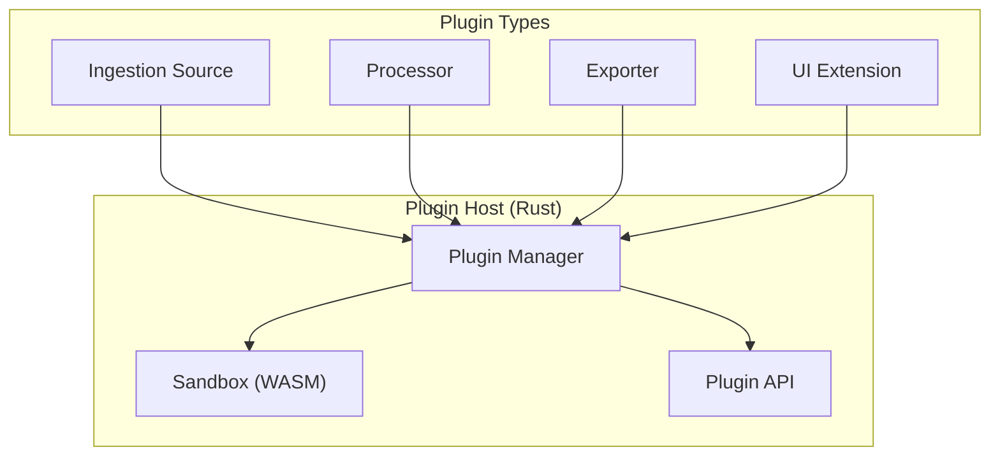
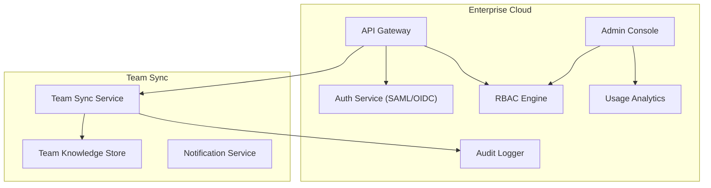
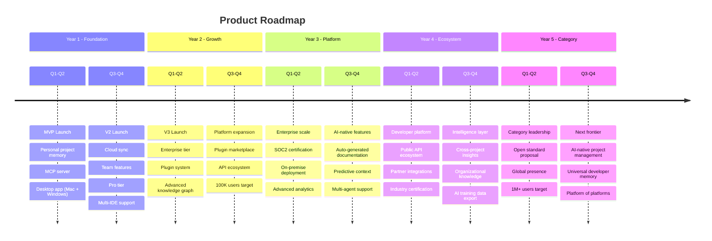

# The Memory Layer for AI Development — Co-Founder Analysis

> A brutally honest strategic, technical, and commercial analysis.

---

## Table of Contents

1. [Honest Critique](#1-honest-critique)
2. [Hidden Risks](#2-hidden-risks)
3. [Competitive Landscape](#3-competitive-landscape)
4. [Market Gaps](#4-market-gaps)
5. [Features You Haven't Considered](#5-features-you-havent-considered)
6. [System Architecture](#6-system-architecture)
7. [Database Design](#7-database-design)
8. [Retrieval Engine](#8-retrieval-engine)
9. [Memory Engine](#9-memory-engine)
10. [Knowledge Graph](#10-knowledge-graph)
11. [MCP Integration](#11-mcp-integration)
12. [Synchronization Engine](#12-synchronization-engine)
13. [Desktop Application Architecture](#13-desktop-application-architecture)
14. [API Design](#14-api-design)
15. [Plugin System](#15-plugin-system)
16. [Enterprise Features](#16-enterprise-features)
17. [Security & Privacy](#17-security--privacy)
18. [Monetization](#18-monetization)
19. [Infrastructure Costs](#19-infrastructure-costs)
20. [MVP (Version 1)](#20-mvp-version-1)
21. [Version 2](#21-version-2)
22. [Version 3](#22-version-3)
23. [Five-Year Roadmap](#23-five-year-roadmap)
24. [Go-to-Market Strategy](#24-go-to-market-strategy)
25. [Why Developers Would Switch](#25-why-developers-would-switch)
26. [Where the Market is Heading](#26-where-the-market-is-heading)
27. [Brand Names](#27-brand-names)

---

## 1. Honest Critique

### What's Strong

Your core insight is correct and well-timed. **Context is the bottleneck, not model quality.** Every developer who's used AI coding tools has felt this pain. The "project is stateful, AI is stateless" framing is powerful and defensible as a positioning narrative.

The local-first, model-agnostic approach is strategically sound—it avoids platform lock-in and positions you as infrastructure rather than an application.

### What Worries Me

> [!CAUTION]
> **The "Universal Context Layer" is a trap narrative.**

Here's the uncomfortable truth: **every AI company is building their own memory layer right now.**

- Anthropic shipped persistent memory in Claude (Projects, memory features)
- OpenAI shipped memory in ChatGPT and custom GPTs
- Cursor has `.cursorrules`, project-level indexing, and persistent context
- Windsurf has Cascade with persistent memory across sessions
- GitHub Copilot has repository-level understanding
- Antigravity (this tool) has knowledge items, skills, and workspace context

You're not entering a vacuum. You're entering a market where every incumbent is racing to solve the same problem as a feature, not as a product.

### The Real Question

**Why would a separate product win against a feature built into the tool developers already use?**

The answer has to be one of:
1. **Cross-tool universality** — works across ALL AI tools (hard to achieve without ecosystem buy-in)
2. **Superior memory quality** — fundamentally better knowledge representation (hard to prove before adoption)
3. **Team/org layer** — something individual tools can't do (most promising angle)
4. **Ownership & portability** — "your memory belongs to you, not to Anthropic" (compelling but niche initially)

My recommendation: **Lead with #3 (team knowledge layer) and #4 (ownership), not #1 (universal context).** Universal context is the long-term vision, but it's a terrible MVP pitch because it requires partnerships you don't have yet.

### The Positioning Problem

"Memory layer for AI development" sounds like infrastructure. Infrastructure companies are either:
- **Standards** (like HTTP, Git) — requires mass adoption before monetization
- **Platforms** (like AWS, Stripe) — requires massive investment
- **Developer tools** (like Linear, Vercel) — requires an opinionated product

You should position as a **developer tool** first, then grow into infrastructure. Don't pitch infrastructure on day one—pitch a product that makes developers 10x more effective with AI tools they already use.

---

## 2. Hidden Risks

| Risk | Severity | Mitigation |
|------|----------|------------|
| **Platform risk**: AI companies build equivalent memory features | 🔴 Critical | Build on open standards (MCP), focus on cross-platform value |
| **Chicken-and-egg**: Need integrations to be useful, need users to get integrations | 🔴 Critical | Start with one integration that works perfectly (VS Code + Claude/GPT) |
| **Context quality**: Bad context is worse than no context | 🟡 High | Invest heavily in retrieval quality; let users curate |
| **Privacy concerns**: Developers won't send proprietary code to another service | 🟡 High | Local-first architecture is correct; make it genuinely local |
| **Token cost**: If you're injecting context, you're increasing API costs for users | 🟡 High | Smart compression, context budgeting, cost transparency |
| **Stale memory**: Outdated context causes worse outputs than no context | 🟡 High | Memory decay, automatic freshness scoring, git-aware invalidation |
| **Enterprise sales cycle**: Long, painful, requires SOC2, SSO, etc. | 🟠 Medium | Start with indie devs and small teams; enterprise comes in V2+ |
| **Open-source competition**: Someone builds an OSS version | 🟠 Medium | Open-source the core, monetize cloud sync + team features |
| **Technical complexity**: Building a good knowledge graph is genuinely hard | 🟠 Medium | Start simple (vector search), layer on graph incrementally |
| **Market timing**: Too early or too late | 🟢 Low | Market timing is good—pain is acute and growing |

### The Risk Nobody Talks About

> [!WARNING]
> **"Memory pollution" could destroy trust in your product.**

If your system injects stale, incorrect, or irrelevant context into an AI conversation, the output gets *worse*. And the user won't blame the AI—they'll blame your product. One bad experience ("it hallucinated because your memory gave it wrong info") and they uninstall.

**This means your retrieval quality has to be near-perfect from day one.** You don't get to iterate your way to good retrieval. It has to work well immediately, or users will leave and never come back.

---

## 3. Competitive Landscape

### Direct Competitors

| Company | What They Do | Strength | Weakness |
|---------|-------------|----------|----------|
| **Pieces.app** | Persistent context for developer workflows | Already has desktop app, IDE plugins, local-first | Tries to do too much; UX is cluttered |
| **Cursor** | AI code editor with project context | Massive adoption, great UX | Locked to their editor; context doesn't leave Cursor |
| **Windsurf (Codeium)** | AI IDE with Cascade memory | Good at multi-step reasoning with context | Also locked to their editor |
| **Continue.dev** | Open-source AI coding assistant | Open source, customizable, config-as-code | Small team, less polished |
| **Cody (Sourcegraph)** | AI assistant with codebase understanding | Deep code graph, enterprise-ready | Tied to Sourcegraph platform |
| **Rewind/Limitless** | Records everything on your machine | Broadest context capture | Not developer-focused; privacy concerns |
| **Mem.ai** | AI-powered knowledge management | Good at personal knowledge | Not developer-specific |
| **Zed** | AI-native code editor | Fast, modern, collaborative | Another locked editor |

### Indirect Competitors (Features Within Platforms)

| Platform | Memory Feature |
|----------|---------------|
| **ChatGPT** | Memory, Custom GPTs, Projects |
| **Claude** | Projects, persistent memory, artifacts |
| **Gemini** | Gems, workspace integration |
| **GitHub Copilot** | Repository-level context, custom instructions |
| **Antigravity** | Knowledge items, skills, workspace context |

### What Nobody Has Built Well

1. **Cross-tool memory** — Nobody owns the "memory that works everywhere" position
2. **Team-shared AI context** — Individual tools have individual memory; team knowledge is fragmented
3. **Decision archaeology** — Why was this architecture chosen? What were the alternatives? This is lost in Slack threads
4. **Context quality scoring** — Nobody tells you "your context is stale" or "this memory contradicts your codebase"
5. **Memory versioning** — Nobody lets you diff your project's knowledge state over time

---

## 4. Market Gaps

### Gap 1: The "Day 2 Developer" Problem
A new developer joins a team. They need to understand the project. Today they read docs (if they exist), search Slack, and ask colleagues. AI tools can't help because they have no project context. **Nobody solves onboarding through AI context.**

### Gap 2: The "Multi-Project Developer" Problem
Freelancers and agency developers work on 5-10 projects. Context switching is brutal. Every time they open a different project, they need to rebuild context in their AI tool. **Nobody handles multi-project context isolation.**

### Gap 3: The "Post-Mortem" Problem
A production incident happens. The team needs to understand what changed, why it was changed, and what the AI suggested. Today, AI conversation history is ephemeral. **Nobody provides AI decision audit trails.**

### Gap 4: The "Standards Drift" Problem
A team agrees on coding standards, architecture patterns, and API conventions. Over time, different team members get different AI suggestions that drift from standards. **Nobody enforces team-level AI consistency.**

### Gap 5: The "Knowledge Decay" Problem
Documentation gets outdated. Architecture docs describe systems that no longer exist. API specs are wrong. If your memory layer ingests stale docs, it makes AI worse. **Nobody automatically detects and flags stale knowledge.**

---

## 5. Features You Haven't Considered

### Critical Missing Features

| Feature | Why It Matters |
|---------|---------------|
| **Context Budget Manager** | Users pay per token. Show them exactly how much context costs and let them set budgets per query |
| **Memory Confidence Score** | Not all memories are equal. Score them by freshness, source reliability, and relevance |
| **Contradiction Detector** | Flag when a new memory contradicts existing knowledge (e.g., "your README says PostgreSQL but your code uses MongoDB") |
| **AI Conversation Replay with Context** | Replay any past AI conversation with the context that was injected—critical for debugging AI behavior |
| **"Forget This" Command** | Let users explicitly tell the system to forget incorrect or outdated information |
| **Context Diff** | Show exactly what context was sent to the AI for each query, and how it changed the response |
| **Onboarding Mode** | When a new developer joins, generate a personalized project briefing based on their role |
| **Migration Assistant** | Import context from existing tools (Cursor rules, Claude projects, ChatGPT memories, Notion, Confluence) |
| **Context Playground** | Let developers test different context combinations to see how they affect AI output quality |
| **Automatic Schema Tracking** | Watch for database migration files and automatically update the schema in project memory |

### Features That Sound Cool But You Should NOT Build (Yet)

| Feature | Why Not |
|---------|---------|
| AI Router (auto-pick best model) | Commodity feature; OpenRouter already does this |
| Multi-Agent Workspace | Too complex for MVP; agents are still immature |
| AI Session Replay | Nice to have, not a purchase driver |
| Figma/Jira/Notion sync | Integration burden is massive; do one well first |
| Project DNA Export | Nobody knows what this means yet |

---

## 6. System Architecture

### High-Level Architecture



### Architecture Principles

1. **Local-first, cloud-optional**: All core functionality works offline. Cloud adds sync and collaboration.
2. **Event-sourced memory**: Every change to project knowledge is an immutable event. This enables versioning, audit trails, and time-travel debugging.
3. **Retrieval over storage**: It's not about storing everything—it's about finding the right thing at the right time.
4. **Model-agnostic**: The context engine outputs structured context that any model can consume.
5. **Plugin-extensible**: Core is lean. Integrations are plugins.

### Technology Choices

| Component | Technology | Rationale |
|-----------|-----------|-----------|
| Desktop App | **Tauri 2.0** (Rust + WebView) | Smaller than Electron, native performance, cross-platform, Rust backend for speed |
| Frontend | **React + TypeScript** | Largest talent pool, mature ecosystem |
| Core Engine | **Rust** | Performance-critical; handles file watching, indexing, embedding generation |
| Local Database | **SQLite (via rusqlite)** | Battle-tested, single-file, no server needed, great for local-first |
| Vector Store | **LanceDB** (embedded) | Rust-native, serverless, columnar format, no separate process |
| Sync Protocol | **CRDTs (Automerge)** | Conflict-free replication for offline-first collaboration |
| IPC | **Tauri Commands + Local HTTP** | Fast for desktop; HTTP enables IDE plugins |
| Embedding Model | **Local (ONNX Runtime)** | No API calls for embedding; privacy-preserving; all-MiniLM-L6-v2 or similar |
| MCP Server | **TypeScript** | MCP SDK is TypeScript-first; easiest path to compatibility |

> [!IMPORTANT]
> **Why Rust for the core engine?**
> The memory engine needs to watch files, parse code, generate embeddings, maintain a knowledge graph, and respond to queries—all concurrently, on the user's machine, without being a resource hog. Python would be too slow. Node.js would use too much memory. Rust gives you the performance of C++ with memory safety guarantees. This is a critical hiring decision—you need strong Rust engineers.

---

## 7. Database Design

### Local Storage Schema (SQLite)

```sql
-- Core entity: a project workspace
CREATE TABLE projects (
    id              TEXT PRIMARY KEY,        -- ULID
    name            TEXT NOT NULL,
    root_path       TEXT NOT NULL,           -- filesystem path
    created_at      INTEGER NOT NULL,        -- unix timestamp
    updated_at      INTEGER NOT NULL,
    config          TEXT NOT NULL DEFAULT '{}', -- JSON
    sync_enabled    BOOLEAN DEFAULT FALSE,
    remote_id       TEXT                     -- cloud project ID
);

-- Immutable event log for all knowledge changes
CREATE TABLE memory_events (
    id              TEXT PRIMARY KEY,        -- ULID (time-ordered)
    project_id      TEXT NOT NULL REFERENCES projects(id),
    event_type      TEXT NOT NULL,           -- 'create' | 'update' | 'archive' | 'forget'
    entity_type     TEXT NOT NULL,           -- 'decision' | 'convention' | 'schema' | ...
    entity_id       TEXT NOT NULL,
    payload         TEXT NOT NULL,           -- JSON: the actual content
    source          TEXT NOT NULL,           -- 'user' | 'git' | 'file_watch' | 'ai_extract' | 'import'
    source_ref      TEXT,                    -- file path, commit hash, conversation ID
    confidence      REAL DEFAULT 1.0,        -- 0.0-1.0; lower for AI-extracted
    created_at      INTEGER NOT NULL,
    vector_id       TEXT,                    -- reference to vector store
    checksum        TEXT NOT NULL            -- SHA-256 of payload for dedup
);

-- Materialized current state of knowledge (derived from events)
CREATE TABLE memory_entities (
    id              TEXT PRIMARY KEY,
    project_id      TEXT NOT NULL REFERENCES projects(id),
    entity_type     TEXT NOT NULL,
    title           TEXT NOT NULL,
    content         TEXT NOT NULL,           -- markdown
    metadata        TEXT NOT NULL DEFAULT '{}', -- JSON
    source          TEXT NOT NULL,
    source_ref      TEXT,
    confidence      REAL DEFAULT 1.0,
    freshness       REAL DEFAULT 1.0,        -- decays over time
    last_accessed   INTEGER,                 -- for LRU-style relevance
    last_validated  INTEGER,                 -- when was this last confirmed accurate
    created_at      INTEGER NOT NULL,
    updated_at      INTEGER NOT NULL,
    archived_at     INTEGER,                 -- soft delete
    vector_id       TEXT
);

-- Knowledge graph edges
CREATE TABLE entity_relations (
    id              TEXT PRIMARY KEY,
    project_id      TEXT NOT NULL REFERENCES projects(id),
    source_id       TEXT NOT NULL REFERENCES memory_entities(id),
    target_id       TEXT NOT NULL REFERENCES memory_entities(id),
    relation_type   TEXT NOT NULL,           -- 'depends_on' | 'contradicts' | 'supersedes' | 'related_to' | 'implements' | 'part_of'
    weight          REAL DEFAULT 1.0,
    metadata        TEXT DEFAULT '{}',
    created_at      INTEGER NOT NULL
);

-- AI conversations with context tracking
CREATE TABLE conversations (
    id              TEXT PRIMARY KEY,
    project_id      TEXT NOT NULL REFERENCES projects(id),
    model           TEXT NOT NULL,           -- 'claude-4' | 'gpt-4o' | etc.
    title           TEXT,
    started_at      INTEGER NOT NULL,
    ended_at        INTEGER,
    total_tokens    INTEGER DEFAULT 0,
    context_cost    REAL DEFAULT 0.0         -- USD cost of injected context
);

CREATE TABLE conversation_messages (
    id              TEXT PRIMARY KEY,
    conversation_id TEXT NOT NULL REFERENCES conversations(id),
    role            TEXT NOT NULL,            -- 'user' | 'assistant' | 'system' | 'context'
    content         TEXT NOT NULL,
    tokens          INTEGER,
    created_at      INTEGER NOT NULL
);

-- What context was injected for each message
CREATE TABLE context_injections (
    id              TEXT PRIMARY KEY,
    message_id      TEXT NOT NULL REFERENCES conversation_messages(id),
    entity_id       TEXT NOT NULL REFERENCES memory_entities(id),
    relevance_score REAL NOT NULL,           -- similarity score
    tokens_used     INTEGER NOT NULL,
    position        INTEGER NOT NULL          -- order in context window
);

-- File tracking for change detection
CREATE TABLE tracked_files (
    id              TEXT PRIMARY KEY,
    project_id      TEXT NOT NULL REFERENCES projects(id),
    file_path       TEXT NOT NULL,
    file_type       TEXT NOT NULL,            -- 'source' | 'config' | 'doc' | 'schema' | 'migration'
    last_hash       TEXT NOT NULL,            -- content hash
    last_indexed    INTEGER NOT NULL,
    last_modified   INTEGER NOT NULL,
    metadata        TEXT DEFAULT '{}'
);

-- Team collaboration (synced entities)
CREATE TABLE team_members (
    id              TEXT PRIMARY KEY,
    project_id      TEXT NOT NULL REFERENCES projects(id),
    user_id         TEXT NOT NULL,
    role            TEXT NOT NULL DEFAULT 'member', -- 'owner' | 'admin' | 'member' | 'viewer'
    joined_at       INTEGER NOT NULL
);

-- Tags for organizing memories
CREATE TABLE tags (
    id              TEXT PRIMARY KEY,
    project_id      TEXT NOT NULL REFERENCES projects(id),
    name            TEXT NOT NULL,
    color           TEXT
);

CREATE TABLE entity_tags (
    entity_id       TEXT NOT NULL REFERENCES memory_entities(id),
    tag_id          TEXT NOT NULL REFERENCES tags(id),
    PRIMARY KEY (entity_id, tag_id)
);

-- Indexes for performance
CREATE INDEX idx_memory_events_project ON memory_events(project_id, created_at DESC);
CREATE INDEX idx_memory_events_entity ON memory_events(entity_id, created_at DESC);
CREATE INDEX idx_memory_entities_project ON memory_entities(project_id, entity_type);
CREATE INDEX idx_memory_entities_freshness ON memory_entities(project_id, freshness DESC);
CREATE INDEX idx_entity_relations_source ON entity_relations(source_id);
CREATE INDEX idx_entity_relations_target ON entity_relations(target_id);
CREATE INDEX idx_tracked_files_project ON tracked_files(project_id);
CREATE INDEX idx_context_injections_message ON context_injections(message_id);
CREATE INDEX idx_conversations_project ON conversations(project_id, started_at DESC);
```

### Entity Types Taxonomy

```
memory_entities.entity_type:
├── architecture        # System design decisions, diagrams, patterns
│   ├── decision        # "We chose PostgreSQL because..."
│   ├── pattern         # "We use Repository pattern for data access"
│   └── diagram         # Architecture diagrams (stored as references)
├── convention          # Coding standards, naming conventions
│   ├── style           # "Use camelCase for variables"
│   ├── structure       # "Put services in /src/services/"
│   └── process         # "All PRs need 2 reviewers"
├── schema              # Database schemas, API contracts
│   ├── database        # Table definitions
│   ├── api             # Endpoint specifications
│   └── event           # Event schemas
├── component           # Code components, modules, services
│   ├── service         # Backend services
│   ├── model           # Data models
│   └── ui              # UI components
├── integration         # External services, APIs, SDKs
├── requirement         # Business requirements, user stories
├── documentation       # Docs, READMEs, guides
├── todo                # Tasks, bugs, tech debt
└── note                # Freeform knowledge, meeting notes
```

---

## 8. Retrieval Engine

### Architecture



### Multi-Stage Retrieval Pipeline

**Stage 1: Query Understanding**
```
Input: "How should I structure the API for user authentication?"
↓
- Intent classification: architecture_query
- Entity extraction: [API, user, authentication]
- Scope detection: project-level (not file-level)
- Temporal relevance: prefer recent decisions
```

**Stage 2: Parallel Search**
```
┌─ Vector Search (semantic similarity)
│  Query embedding → top-k from LanceDB
│  Returns: ranked entity IDs with similarity scores
│
├─ Full-Text Search (keyword matching)  
│  SQLite FTS5 index
│  Returns: ranked entity IDs with BM25 scores
│
└─ Graph Traversal (relationship-based)
   Starting from matched entities, traverse 1-2 hops
   Returns: related entities with graph distance scores
```

**Stage 3: Fusion & Re-ranking**
```python
# Reciprocal Rank Fusion (RRF) across search methods
def fuse_results(vector_results, fts_results, graph_results, k=60):
    scores = {}
    for method_results in [vector_results, fts_results, graph_results]:
        for rank, (entity_id, _) in enumerate(method_results):
            scores[entity_id] = scores.get(entity_id, 0) + 1 / (k + rank)
    
    # Apply freshness decay
    for entity_id in scores:
        entity = get_entity(entity_id)
        freshness_multiplier = entity.freshness  # 0.0 - 1.0
        confidence_multiplier = entity.confidence
        scores[entity_id] *= freshness_multiplier * confidence_multiplier
    
    return sorted(scores.items(), key=lambda x: -x[1])
```

**Stage 4: Context Budget Allocation**
```
Total budget: 8,000 tokens (user-configurable)
├── High relevance (score > 0.8): up to 60% of budget
├── Medium relevance (0.5-0.8): up to 30% of budget
└── Supporting context (0.3-0.5): up to 10% of budget

Each entity is compressed/summarized to fit budget constraints.
If entity is too large, extract only the relevant section.
```

**Stage 5: Context Compilation**
```
Output format (injected as system prompt or tool context):

<project_context>
  <architecture>
    - Auth uses JWT tokens stored in HttpOnly cookies
    - API follows RESTful conventions with /api/v1/ prefix
    - Rate limiting: 100 req/min per user
  </architecture>
  <conventions>
    - Error responses follow RFC 7807 (Problem Details)
    - All endpoints require authentication except /auth/*
  </conventions>
  <schema>
    - users table: id (UUID), email, password_hash, created_at
    - sessions table: id, user_id (FK), token, expires_at
  </schema>
  <recent_decisions>
    - [2024-12-15] Decided against OAuth2 for V1, using simple JWT
    - [2024-12-10] Chose bcrypt over argon2 for password hashing
  </recent_decisions>
</project_context>
```

### Embedding Strategy

| Content Type | Embedding Approach |
|-------------|-------------------|
| Short text (< 512 tokens) | Single embedding |
| Long documents | Chunked with 256-token overlap, multiple embeddings |
| Code files | Function/class-level chunks with metadata |
| Conversations | Per-message embeddings with conversation ID grouping |
| Schemas | Structured extraction + embedding of description |

### Freshness Decay Function

```python
import math
from datetime import datetime, timedelta

def calculate_freshness(entity, current_time):
    """
    Freshness decays logarithmically.
    - Entities updated today: ~1.0
    - Entities from last week: ~0.85
    - Entities from last month: ~0.70
    - Entities from 6 months ago: ~0.50
    - Entities from 1 year ago: ~0.35
    
    Validation resets the decay clock.
    Entities from git commits decay slower (more trustworthy source).
    """
    last_touched = max(entity.updated_at, entity.last_validated or 0)
    age_days = (current_time - last_touched) / 86400  # seconds to days
    
    # Base decay
    freshness = 1.0 / (1.0 + math.log1p(age_days / 30))
    
    # Source trust multiplier
    source_trust = {
        'user': 1.0,       # User explicitly stated this
        'git': 0.95,       # Extracted from committed code
        'file_watch': 0.85, # Auto-detected from file changes
        'ai_extract': 0.70, # AI extracted from conversations
        'import': 0.80      # Imported from external tool
    }
    freshness *= source_trust.get(entity.source, 0.75)
    
    # Access recency boost (recently accessed = likely still relevant)
    if entity.last_accessed:
        access_age = (current_time - entity.last_accessed) / 86400
        if access_age < 7:
            freshness = min(1.0, freshness * 1.15)
    
    return max(0.1, min(1.0, freshness))  # Clamp to [0.1, 1.0]
```

---

## 9. Memory Engine

### Core Principles

1. **Append-only event log**: Never mutate; always append. Enables versioning, undo, and audit trails.
2. **Materialized views**: Current state is derived from events, not stored directly.
3. **Multi-source ingestion**: Accept knowledge from files, git, conversations, manual input, and integrations.
4. **Confidence scoring**: Not all memories are equal. User-stated facts > code-extracted facts > AI-inferred facts.

### Memory Lifecycle



### Ingestion Pipeline

```
Source → Parser → Extractor → Deduplicator → Enricher → Indexer → Store

Sources:
├── File Watcher (fs events via notify-rs)
│   ├── Config files → parse and extract settings
│   ├── Package files → extract dependencies
│   ├── Migration files → extract schema changes
│   ├── README/docs → extract project documentation
│   └── Source code → extract function signatures, comments, TODOs
│
├── Git Integration
│   ├── Commit messages → extract decisions and changes
│   ├── Diffs → detect schema/API changes
│   ├── Branch names → extract feature context
│   └── .gitignore → understand project structure
│
├── AI Conversations (via MCP)
│   ├── User messages → extract implicit decisions
│   ├── AI responses → extract recommendations adopted
│   └── Code suggestions → extract patterns used
│
├── Manual Input
│   ├── User-written memories → highest confidence
│   ├── Quick capture → voice/text notes
│   └── Imports → from Notion, Confluence, etc.
│
└── IDE Integration
    ├── Open files → understand current focus
    ├── Debug sessions → capture error context
    └── Terminal commands → capture environment info
```

### Automatic Knowledge Extraction

For each file type, the engine extracts specific knowledge:

| File | Extracted Knowledge |
|------|-------------------|
| `package.json` / `Cargo.toml` | Dependencies, versions, scripts |
| `docker-compose.yml` | Services, ports, environment vars |
| `*.env.example` | Required environment variables |
| `.cursorrules` / `AGENTS.md` | Existing AI instructions (import!) |
| `openapi.yaml` / `swagger.json` | API endpoints, models |
| `schema.prisma` / `*.sql` | Database schema |
| `tsconfig.json` / `eslint.config` | Coding conventions |
| `README.md` | Project overview |
| `CHANGELOG.md` | Version history, decisions |
| `Makefile` / `justfile` | Build/deploy commands |
| `*.test.*` / `*.spec.*` | Testing patterns |

### Memory Conflict Resolution

```
When: Entity A (existing) conflicts with Entity B (new)

1. Auto-resolve if possible:
   - B is from a more trusted source → B supersedes A
   - B is from git commit, A is from file_watch → B supersedes A
   - B.updated_at > A.updated_at AND same source → B supersedes A

2. Flag for manual resolution:
   - Different sources, similar confidence
   - Architectural contradiction (e.g., "use REST" vs "use GraphQL")
   - Create a "conflict" relation between A and B
   - Surface in UI for user resolution

3. Keep both if complementary:
   - A and B describe different aspects of the same entity
   - Merge into a single entity with combined content
```

---

## 10. Knowledge Graph

### Graph Model



### Graph Storage

The knowledge graph is stored in SQLite using an adjacency list model (the `entity_relations` table). For the MVP, this is sufficient. If graph queries become complex, we can add a graph query layer on top.

### Graph Query Patterns

```sql
-- Find all decisions that affect the auth module
SELECT d.* FROM memory_entities d
JOIN entity_relations r ON d.id = r.source_id
JOIN memory_entities m ON r.target_id = m.id
WHERE r.relation_type = 'affects'
  AND m.entity_type = 'component'
  AND m.title LIKE '%auth%';

-- Find the dependency chain for a service
WITH RECURSIVE deps AS (
    SELECT target_id, 1 as depth
    FROM entity_relations
    WHERE source_id = ?
      AND relation_type = 'depends_on'
    UNION ALL
    SELECT er.target_id, deps.depth + 1
    FROM entity_relations er
    JOIN deps ON er.source_id = deps.target_id
    WHERE er.relation_type = 'depends_on'
      AND deps.depth < 5  -- max depth
)
SELECT DISTINCT me.* FROM deps
JOIN memory_entities me ON deps.target_id = me.id;

-- Find contradicting decisions
SELECT a.title as decision_a, b.title as decision_b
FROM entity_relations r
JOIN memory_entities a ON r.source_id = a.id
JOIN memory_entities b ON r.target_id = b.id
WHERE r.relation_type = 'contradicts';
```

### Automatic Relation Discovery

The system automatically discovers relations through:

1. **Co-occurrence**: Entities mentioned in the same file/conversation are `related_to`
2. **Import analysis**: Code imports create `depends_on` edges
3. **Temporal proximity**: Decisions made close together about the same module are `related_to`
4. **Semantic similarity**: Entities with high embedding similarity are `related_to`
5. **Explicit markers**: User can manually create relations
6. **AI extraction**: When processing conversations, extract stated relationships

---

## 11. MCP Integration

### Why MCP is Critical

MCP (Model Context Protocol) is becoming the standard for how AI tools access external data. By implementing an MCP server, your memory layer becomes instantly accessible from:
- Claude Desktop
- VS Code with Copilot
- Cursor
- Windsurf
- Any MCP-compatible client

**This is your distribution strategy.** Instead of building your own chat interface, piggyback on tools developers already use.

### MCP Server Design

```typescript
// MCP Tool definitions

const tools = [
  {
    name: "recall",
    description: "Retrieve relevant project context for a given question or task",
    inputSchema: {
      type: "object",
      properties: {
        query: {
          type: "string",
          description: "The question or task to retrieve context for"
        },
        entity_types: {
          type: "array",
          items: { type: "string" },
          description: "Filter by entity type: decision, convention, schema, etc."
        },
        max_tokens: {
          type: "number",
          description: "Maximum tokens of context to return",
          default: 4000
        }
      },
      required: ["query"]
    }
  },
  {
    name: "remember",
    description: "Store a new piece of project knowledge",
    inputSchema: {
      type: "object",
      properties: {
        title: { type: "string" },
        content: { type: "string" },
        entity_type: {
          type: "string",
          enum: ["decision", "convention", "schema", "component", "requirement", "note"]
        },
        source: {
          type: "string",
          description: "Where this knowledge came from"
        }
      },
      required: ["title", "content", "entity_type"]
    }
  },
  {
    name: "forget",
    description: "Archive outdated or incorrect knowledge",
    inputSchema: {
      type: "object",
      properties: {
        entity_id: { type: "string" },
        reason: { type: "string" }
      },
      required: ["entity_id"]
    }
  },
  {
    name: "decide",
    description: "Record an architecture or design decision with rationale",
    inputSchema: {
      type: "object",
      properties: {
        title: { type: "string" },
        decision: { type: "string" },
        rationale: { type: "string" },
        alternatives_considered: {
          type: "array",
          items: { type: "string" }
        },
        affects: {
          type: "array",
          items: { type: "string" },
          description: "Components or modules affected by this decision"
        }
      },
      required: ["title", "decision", "rationale"]
    }
  },
  {
    name: "conventions",
    description: "Get all coding conventions for the current project",
    inputSchema: {
      type: "object",
      properties: {
        scope: {
          type: "string",
          enum: ["all", "style", "structure", "process"],
          default: "all"
        }
      }
    }
  },
  {
    name: "history",
    description: "Get the timeline of decisions and changes for a component",
    inputSchema: {
      type: "object",
      properties: {
        component: { type: "string" },
        limit: { type: "number", default: 10 }
      },
      required: ["component"]
    }
  },
  {
    name: "context_status",
    description: "Get the current state of project memory - what's known, what's stale, what's conflicting",
    inputSchema: {
      type: "object",
      properties: {}
    }
  }
];

// MCP Resources (passive context)
const resources = [
  {
    uri: "memory://project/summary",
    name: "Project Summary",
    description: "High-level overview of the project",
    mimeType: "text/markdown"
  },
  {
    uri: "memory://project/tech-stack",
    name: "Technology Stack",
    description: "All technologies, frameworks, and tools used",
    mimeType: "text/markdown"
  },
  {
    uri: "memory://project/architecture",
    name: "Architecture Overview",
    description: "System architecture, services, and their relationships",
    mimeType: "text/markdown"
  },
  {
    uri: "memory://project/conventions",
    name: "Coding Conventions",
    description: "All coding standards and conventions",
    mimeType: "text/markdown"
  },
  {
    uri: "memory://project/schema",
    name: "Database Schema",
    description: "Current database schema and models",
    mimeType: "text/markdown"
  },
  {
    uri: "memory://project/recent-decisions",
    name: "Recent Decisions",
    description: "Architecture and design decisions from the last 30 days",
    mimeType: "text/markdown"
  }
];
```

### MCP Prompt Templates

```typescript
const prompts = [
  {
    name: "project_briefing",
    description: "Generate a comprehensive project briefing for a new team member",
    arguments: [
      { name: "role", description: "The role of the new team member", required: false }
    ]
  },
  {
    name: "decision_review",
    description: "Review all decisions related to a component and check for conflicts",
    arguments: [
      { name: "component", description: "The component to review", required: true }
    ]
  },
  {
    name: "context_for_task",
    description: "Compile all relevant context for a specific development task",
    arguments: [
      { name: "task_description", description: "Description of the task", required: true }
    ]
  }
];
```

---

## 12. Synchronization Engine

### Sync Architecture



### Sync Strategy

**CRDT-based conflict resolution using Automerge:**

```rust
// Each memory entity is a CRDT document
// Changes are automatically merged without conflicts

struct SyncableEntity {
    // Automerge document containing:
    id: EntityId,
    content: AutomergeText,      // Text CRDT for content
    metadata: AutomergeMap,      // Map CRDT for metadata
    tags: AutomergeList,         // List CRDT for tags
    vector_clock: VectorClock,   // For causal ordering
}

// Sync protocol:
// 1. Client generates Automerge "sync message" (compact binary)
// 2. Server receives, merges into central state
// 3. Server broadcasts delta to other clients
// 4. Clients apply delta to local state
// 5. No conflicts possible (CRDT guarantee)
```

### What Gets Synced

| Data | Synced? | Why |
|------|---------|-----|
| Memory entities | ✅ Yes | Core collaborative data |
| Entity relations | ✅ Yes | Knowledge graph structure |
| Tags | ✅ Yes | Shared organization |
| Conversations | ⚠️ Optional | Privacy-sensitive; user chooses |
| File tracking data | ❌ No | Machine-specific |
| Vector embeddings | ❌ No | Re-generated locally |
| User preferences | ❌ No | Per-device |

### Offline-First Guarantees

1. All operations work offline immediately
2. Changes are queued in a local WAL (Write-Ahead Log)
3. On reconnection, sync engine replays queued changes
4. CRDT merge guarantees no data loss
5. Conflict resolution is automatic (no manual merge needed)
6. If the cloud goes down, your project memory is unaffected

---

## 13. Desktop Application Architecture

### Technology Stack

```
┌─────────────────────────────────┐
│        Tauri 2.0 Shell          │
│  (Native window, system tray,  │
│   file dialogs, notifications)  │
├─────────────────────────────────┤
│        React Frontend           │
│  (TypeScript, Vite, Zustand)    │
├─────────────────────────────────┤
│        Tauri IPC Bridge         │
│   (Commands, Events, State)     │
├─────────────────────────────────┤
│        Rust Core Engine         │
│  ┌──────────┬──────────┐       │
│  │ Memory   │ Retrieval│       │
│  │ Engine   │ Engine   │       │
│  ├──────────┼──────────┤       │
│  │ Knowledge│ Context  │       │
│  │ Graph    │ Compiler │       │
│  ├──────────┼──────────┤       │
│  │ File     │ Git      │       │
│  │ Watcher  │ Integr.  │       │
│  ├──────────┼──────────┤       │
│  │ Sync     │ Plugin   │       │
│  │ Engine   │ Runtime  │       │
│  └──────────┴──────────┘       │
├─────────────────────────────────┤
│        Storage Layer            │
│  SQLite │ LanceDB │ File System │
├─────────────────────────────────┤
│        System Services          │
│  MCP Server │ HTTP API │ WS    │
└─────────────────────────────────┘
```

### Application Layout Concept

```
┌─────────────────────────────────────────────────────────────┐
│  [≡] ProjectName ▾    [🔍 Search memories...]    [⚙️] [👤] │
├────────────┬────────────────────────────────────────────────┤
│            │                                                │
│  PROJECTS  │  Memory Dashboard                              │
│  ─────────  │  ┌────────────────────────────────────────┐   │
│  ● MyApp   │  │ 📊 Context Health Score: 87/100        │   │
│  ○ Backend │  │ 23 active memories │ 3 stale │ 1 conflict│  │
│  ○ Mobile  │  └────────────────────────────────────────┘   │
│            │                                                │
│  KNOWLEDGE │  Recent Activity                               │
│  ─────────  │  ├─ 🏗️ Architecture decision: Use PostgreSQL │
│  ▶ Arch.   │  ├─ 📝 Convention added: Error handling       │
│  ▶ Schema  │  ├─ 🔄 Schema updated: users table           │
│  ▶ APIs    │  └─ ⚠️ Conflict: Auth approach                │
│  ▶ Stack   │                                                │
│  ▶ Conven. │  Knowledge Graph (interactive)                 │
│  ▶ Decis.  │  ┌────────────────────────────────────────┐   │
│            │  │     [Auth] ──── [Users API]             │   │
│  ACTIONS   │  │       │              │                  │   │
│  ─────────  │  │    [JWT] ──── [Sessions]               │   │
│  + Memory  │  │       │                                 │   │
│  ↻ Rescan  │  │    [bcrypt]                             │   │
│  ⚡ Status │  └────────────────────────────────────────┘   │
│            │                                                │
├────────────┴────────────────────────────────────────────────┤
│  MCP: Connected │ Last sync: 2 min ago │ Tokens today: 12k │
└─────────────────────────────────────────────────────────────┘
```

### Key Desktop Features

1. **System tray**: Always running, watching files, serving MCP
2. **Quick capture**: Global hotkey to capture a thought/decision (like Raycast)
3. **Project switching**: Instant context switch between projects
4. **Memory browser**: Search, filter, and curate project knowledge
5. **Knowledge graph visualization**: Interactive graph of project concepts
6. **Context inspector**: See exactly what context would be sent for a query
7. **Integration status**: Monitor MCP connections, sync status, file watching

---

## 14. API Design

### REST API (Local HTTP Server)

```yaml
# Runs on localhost:PORT, serves IDE plugins and external integrations

# Project Management
GET    /api/v1/projects                    # List all projects
POST   /api/v1/projects                    # Create project
GET    /api/v1/projects/:id                # Get project details
PUT    /api/v1/projects/:id                # Update project
DELETE /api/v1/projects/:id                # Delete project

# Memory Operations
GET    /api/v1/projects/:id/memories       # List memories (with filters)
POST   /api/v1/projects/:id/memories       # Create memory
GET    /api/v1/projects/:id/memories/:mid  # Get specific memory
PUT    /api/v1/projects/:id/memories/:mid  # Update memory
DELETE /api/v1/projects/:id/memories/:mid  # Archive memory (soft delete)

# Retrieval
POST   /api/v1/projects/:id/recall         # Retrieve relevant context
  # Body: { query, entity_types?, max_tokens?, min_confidence? }
  # Returns: { context, entities[], tokens_used, cost_estimate }

POST   /api/v1/projects/:id/search         # Search memories
  # Body: { query, filters?, limit?, offset? }

# Knowledge Graph
GET    /api/v1/projects/:id/graph          # Get full graph
GET    /api/v1/projects/:id/graph/node/:nid # Get node with relations
POST   /api/v1/projects/:id/graph/relations # Create relation

# Conversations
GET    /api/v1/projects/:id/conversations   # List conversations
GET    /api/v1/projects/:id/conversations/:cid # Get conversation with context
POST   /api/v1/projects/:id/conversations/:cid/context # Get injected context for a message

# System
GET    /api/v1/status                       # Health check, connection status
POST   /api/v1/projects/:id/rescan          # Trigger full rescan
GET    /api/v1/projects/:id/stats           # Memory stats, health score
GET    /api/v1/projects/:id/conflicts       # List unresolved conflicts
```

### WebSocket API (Real-time)

```typescript
// Connection: ws://localhost:PORT/ws/projects/:id

// Server → Client events
interface ServerEvent {
  type: 
    | 'memory.created'      // New memory added
    | 'memory.updated'      // Memory modified
    | 'memory.archived'     // Memory archived
    | 'memory.conflict'     // New conflict detected
    | 'index.progress'      // Indexing progress update
    | 'index.complete'      // Indexing finished
    | 'sync.status'         // Sync status change
    | 'file.changed'        // Tracked file changed
    ;
  payload: Record<string, any>;
  timestamp: number;
}

// Client → Server commands
interface ClientCommand {
  type:
    | 'subscribe'           // Subscribe to specific event types
    | 'unsubscribe'
    ;
  payload: Record<string, any>;
}
```

---

## 15. Plugin System

### Plugin Architecture



### Plugin Types

| Type | Purpose | Example |
|------|---------|---------|
| **Source** | Ingest knowledge from external systems | Notion importer, Jira sync, Confluence reader |
| **Processor** | Transform or analyze knowledge | Code complexity analyzer, dependency tracker |
| **Exporter** | Export knowledge to other formats | Markdown exporter, ADR generator |
| **UI** | Add panels or views to the desktop app | Custom dashboard widgets |
| **Provider** | Connect to AI providers | Custom model provider, local LLM connector |

### Plugin Manifest

```json
{
  "name": "notion-sync",
  "version": "1.0.0",
  "type": "source",
  "description": "Sync project knowledge from Notion pages",
  "author": "Community",
  "license": "MIT",
  "entry": "dist/index.wasm",
  "permissions": [
    "network:notion.so",
    "memory:read",
    "memory:write"
  ],
  "config_schema": {
    "type": "object",
    "properties": {
      "notion_token": { "type": "string", "secret": true },
      "database_id": { "type": "string" },
      "sync_interval_minutes": { "type": "number", "default": 30 }
    },
    "required": ["notion_token", "database_id"]
  }
}
```

### Plugin API (Rust → WASM boundary)

```rust
// Host functions available to plugins
trait PluginHost {
    // Memory operations
    fn create_memory(entity: MemoryEntity) -> Result<EntityId>;
    fn update_memory(id: EntityId, update: MemoryUpdate) -> Result<()>;
    fn query_memories(query: MemoryQuery) -> Result<Vec<MemoryEntity>>;
    
    // HTTP (sandboxed to allowed domains)
    fn http_request(request: HttpRequest) -> Result<HttpResponse>;
    
    // Storage (plugin-scoped)
    fn storage_get(key: &str) -> Result<Option<Vec<u8>>>;
    fn storage_set(key: &str, value: &[u8]) -> Result<()>;
    
    // Logging
    fn log(level: LogLevel, message: &str);
    
    // Config
    fn get_config() -> Result<serde_json::Value>;
}

// Plugin interface
trait Plugin {
    fn init(host: &dyn PluginHost) -> Result<()>;
    fn on_event(event: PluginEvent) -> Result<()>;
    fn shutdown() -> Result<()>;
}

// Source plugin interface
trait SourcePlugin: Plugin {
    fn sync() -> Result<Vec<MemoryEntity>>;
    fn supports_incremental() -> bool;
}
```

### Plugin Distribution

- **Phase 1**: Git-based (clone into plugins directory)
- **Phase 2**: Registry (`plugin install notion-sync`)
- **Phase 3**: Marketplace (with reviews, verification, monetization)

---

## 16. Enterprise Features

### Enterprise Tier Capabilities

| Feature | Individual | Team | Enterprise |
|---------|-----------|------|------------|
| Local project memory | ✅ | ✅ | ✅ |
| MCP server | ✅ | ✅ | ✅ |
| Cloud sync | ❌ | ✅ | ✅ |
| Team shared memories | ❌ | ✅ | ✅ |
| Role-based access (RBAC) | ❌ | Basic | Full |
| SSO (SAML/OIDC) | ❌ | ❌ | ✅ |
| Audit logs | ❌ | ❌ | ✅ |
| Custom retention policies | ❌ | ❌ | ✅ |
| Admin console | ❌ | ❌ | ✅ |
| Priority support | ❌ | ❌ | ✅ |
| On-premise deployment | ❌ | ❌ | ✅ |
| Custom integrations | ❌ | ❌ | ✅ |
| Compliance (SOC2, HIPAA) | ❌ | ❌ | ✅ |
| Usage analytics | ❌ | Basic | Advanced |

### Enterprise Architecture Additions



### Enterprise Knowledge Governance

```
Knowledge Policies:
├── Retention: How long memories are kept
├── Classification: Public / Internal / Confidential / Restricted
├── Sharing: Who can see what
├── Export: Who can export project knowledge
├── AI Usage: Which AI models can receive which knowledge
└── Compliance: Which memories are subject to regulatory requirements
```

---

## 17. Security & Privacy

### Security Architecture

```
┌─────────────────────────────────────────┐
│            Security Layers              │
├─────────────────────────────────────────┤
│ 1. Encryption at rest (SQLite SEE or   │
│    SQLCipher for local DB encryption)   │
├─────────────────────────────────────────┤
│ 2. Encryption in transit (TLS 1.3 for  │
│    all cloud sync, mTLS for enterprise)│
├─────────────────────────────────────────┤
│ 3. Zero-knowledge sync (encrypt before │
│    upload, decrypt after download)      │
├─────────────────────────────────────────┤
│ 4. Plugin sandboxing (WASM sandbox,    │
│    explicit permission grants)          │
├─────────────────────────────────────────┤
│ 5. Local-only by default (no data      │
│    leaves device unless user opts in)   │
├─────────────────────────────────────────┤
│ 6. Audit logging (every access to      │
│    memories is logged for enterprise)   │
└─────────────────────────────────────────┘
```

### Key Security Decisions

| Decision | Choice | Rationale |
|----------|--------|-----------|
| Default data location | **Local only** | Privacy-first; builds trust |
| Sync encryption | **End-to-end (E2E)** | Server never sees plaintext |
| Key management | **Device-generated keys** | User controls keys |
| AI model communication | **User's own API keys** | We never proxy AI calls |
| Plugin permissions | **Explicit, granular** | Plugins declare required permissions |
| Authentication | **Passkeys + OAuth** | Modern, phishing-resistant |
| Embedding generation | **Local model (ONNX)** | No code/text sent to embedding APIs |

### Data Flow Security

```
User's Code → [Local Parser] → [Local Embeddings] → [Local Vector DB]
                                                         ↓
                                                    [MCP Server]
                                                         ↓
                                                  [AI Provider]
                                                  (User's API key,
                                                   only relevant
                                                   context sent)
```

> [!IMPORTANT]
> **Critical privacy guarantee**: We never see, store, or process user code on our servers. Embeddings are generated locally. AI calls use the user's own API keys. Cloud sync is end-to-end encrypted. This is a core differentiator and must never be compromised.

---

## 18. Monetization

### Pricing Strategy

```
┌──────────────┬──────────────┬──────────────┬──────────────┐
│    FREE      │   PRO        │   TEAM       │  ENTERPRISE  │
│              │              │              │              │
│  $0/mo       │  $12/mo      │  $20/user/mo │  Custom      │
│              │              │              │              │
│  1 project   │  Unlimited   │  Everything  │  Everything  │
│  Local only  │  projects    │  in Pro +    │  in Team +   │
│  Core MCP    │  Cloud sync  │  Team sync   │  SSO/SAML    │
│  Basic       │  Priority    │  Shared      │  Audit logs  │
│  memory      │  indexing    │  memories    │  Admin       │
│              │  Advanced    │  RBAC        │  console     │
│              │  retrieval   │  Comments    │  On-premise  │
│              │  All plugins │  Analytics   │  SOC2        │
│              │              │              │  SLA         │
│              │              │              │  Dedicated   │
│              │              │              │  support     │
└──────────────┴──────────────┴──────────────┴──────────────┘
```

### Revenue Projections (Conservative)

| Year | Users | Paid Conversion | MRR | ARR |
|------|-------|----------------|-----|-----|
| Y1 | 5,000 | 5% (250) | $3,000 | $36K |
| Y2 | 50,000 | 8% (4,000) | $60,000 | $720K |
| Y3 | 200,000 | 10% (20,000) | $320,000 | $3.8M |
| Y4 | 500,000 | 12% (60,000) | $1.2M | $14.4M |
| Y5 | 1,000,000 | 15% (150,000) | $3.5M | $42M |

### Additional Revenue Streams

1. **Plugin marketplace** (15-30% commission)
2. **Enterprise contracts** ($50K-500K/year)
3. **Professional services** (custom integrations, onboarding)
4. **Certification program** (for consultants/agencies)
5. **Data insights** (anonymized, aggregated developer productivity insights — opt-in only)

---

## 19. Infrastructure Costs

### Local-First Advantage

Because the core product runs locally, infrastructure costs are dramatically lower than typical SaaS:

| Service | Monthly Cost (at 50K users) | Notes |
|---------|---------------------------|-------|
| **Sync Server** | $500-1,000 | Small instances; handles deltas only |
| **Auth Service** | $200-400 | Auth0 or Clerk |
| **Database (Cloud)** | $300-600 | PlanetScale or Neon; only sync metadata |
| **Object Storage** | $100-200 | S3; encrypted blobs only |
| **CDN** | $100-200 | App updates, plugin registry |
| **Monitoring** | $200-400 | Datadog or Grafana Cloud |
| **CI/CD** | $200-400 | GitHub Actions |
| **Domain + DNS** | $20 | Cloudflare |
| **Email (transactional)** | $50-100 | Resend or Postmark |
| **Total** | **$1,670-3,320/mo** | |

This is extremely low compared to typical SaaS because:
- No GPU costs (embeddings are local)
- No vector DB hosting (LanceDB is local)
- No AI API costs (users use their own keys)
- Minimal data transfer (CRDT deltas are tiny)

### Cost Scaling

| Users | Monthly Infra Cost | Cost Per User |
|-------|-------------------|---------------|
| 1,000 | ~$500 | $0.50 |
| 10,000 | ~$1,500 | $0.15 |
| 50,000 | ~$3,000 | $0.06 |
| 100,000 | ~$6,000 | $0.06 |
| 500,000 | ~$15,000 | $0.03 |

**Gross margin at scale: ~95%** — This is infrastructure-SaaS economics at its best.

---

## 20. MVP (Version 1)

### Timeline: 3-4 months

### MVP Scope: "Personal AI Memory for One IDE"

> [!TIP]
> **The MVP should make ONE workflow dramatically better, not make all workflows slightly better.**

**The workflow**: A developer using Claude/ChatGPT through VS Code (via MCP) wants their AI to remember project context across sessions.

### MVP Features

| Feature | Priority | Effort |
|---------|----------|--------|
| Tauri desktop app (system tray + basic UI) | P0 | 3 weeks |
| Project creation + configuration | P0 | 1 week |
| File watcher + automatic indexing | P0 | 2 weeks |
| SQLite storage + memory CRUD | P0 | 1 week |
| Local embedding generation (ONNX) | P0 | 2 weeks |
| LanceDB vector search | P0 | 1 week |
| Basic retrieval pipeline | P0 | 2 weeks |
| MCP server (recall + remember tools) | P0 | 2 weeks |
| Memory browser UI (list, search, edit) | P0 | 2 weeks |
| Manual memory creation | P0 | 0.5 week |
| Project summary dashboard | P1 | 1 week |
| Git integration (extract from commits) | P1 | 1.5 weeks |
| Context inspector ("show what was sent") | P1 | 1 week |

### MVP Team

| Role | Count | Why |
|------|-------|-----|
| Rust Engineer | 1-2 | Core engine, file watching, embedding, LanceDB |
| Full-Stack (React/TS) | 1 | Desktop UI, MCP server |
| Product/Design | 1 | UX, testing, docs |
| **Total** | **3-4** | |

### MVP Success Metrics

- **Activation**: 50% of users who install create a project and use MCP within first session
- **Retention**: 30% weekly active after 4 weeks
- **NPS**: > 40 from early adopters
- **Context Quality**: Users report AI responses are "better with context" > 70% of the time

### MVP Anti-Patterns (Things to Avoid)

- ❌ Don't build cloud sync in MVP
- ❌ Don't build team features in MVP
- ❌ Don't build a chat interface (use MCP instead)
- ❌ Don't support multiple IDEs in MVP (pick one)
- ❌ Don't build a plugin system in MVP
- ❌ Don't build authentication in MVP (it's local-only)

---

## 21. Version 2

### Timeline: Months 4-8

### Theme: "Team Memory + Cloud Sync"

| Feature | Priority |
|---------|----------|
| Cloud sync (CRDT-based) | P0 |
| User authentication (OAuth) | P0 |
| Team shared memories | P0 |
| Pro tier monetization | P0 |
| Multiple IDE support (VS Code, Cursor, Windsurf) | P0 |
| Full-text search (FTS5) | P1 |
| Knowledge graph (basic) | P1 |
| Contradiction detection | P1 |
| Freshness decay + stale alerts | P1 |
| Memory confidence scoring | P1 |
| Context budget management | P1 |
| Import from .cursorrules / Claude Projects | P2 |
| API documentation auto-extraction | P2 |
| Decision timeline view | P2 |

### V2 Team Growth

Add: 1 backend engineer (cloud sync), 1 frontend engineer, 1 DevRel/community

---

## 22. Version 3

### Timeline: Months 8-14

### Theme: "Enterprise + Ecosystem"

| Feature | Priority |
|---------|----------|
| Enterprise tier (SSO, RBAC, audit) | P0 |
| Plugin system (WASM-based) | P0 |
| Plugin marketplace | P1 |
| Admin console | P0 |
| Advanced knowledge graph + visualization | P1 |
| AI conversation replay with context | P1 |
| Onboarding mode (project briefing generator) | P1 |
| Notion/Confluence/Jira plugins | P1 |
| CLI tool | P2 |
| Web dashboard | P2 |
| Context playground | P2 |
| Mobile companion (read-only) | P3 |

### V3 Team Growth

Add: 2 engineers (enterprise), 1 designer, 1 sales (enterprise), 1 support

---

## 23. Five-Year Roadmap



### Key Milestones

| Milestone | Target Date | Criteria |
|-----------|------------|----------|
| MVP launch | Month 4 | 100 beta users |
| Product-market fit signal | Month 8 | 40% weekly retention, NPS > 50 |
| First revenue | Month 6 | First Pro subscriber |
| $1M ARR | Month 24 | ~4,500 paid users |
| Series A | Month 18-24 | PMF + $500K+ ARR |
| Enterprise first deal | Month 14 | $50K+ contract |
| $10M ARR | Month 42 | ~35,000 paid users |
| 100K total users | Month 24 | |
| 1M total users | Month 54 | |

---

## 24. Go-to-Market Strategy

### Phase 1: Developer Credibility (Months 0-4)

1. **Build in public**: Share architecture decisions, technical blog posts, demos on Twitter/X
2. **Open-source the MCP server**: Let anyone try the MCP integration without the desktop app
3. **Launch on Product Hunt / Hacker News**: Developer audiences
4. **Create a Discord community**: Early adopter feedback loop
5. **Partner with developer influencers**: Send early access to developers with 10K+ followers
6. **Target the pain**: Marketing copy focuses on specific pain points, not features
   - "Stop explaining your project to AI. Every. Single. Time."
   - "Your project deserves a memory."
   - "AI that remembers what you decided last Tuesday."

### Phase 2: Community Growth (Months 4-10)

1. **Free tier with generous limits**: Get adoption, worry about conversion later
2. **Integration partnerships**: Work with Cursor, Continue.dev, and other AI tools
3. **Content marketing**: "How to give your AI tools persistent memory" (SEO play)
4. **Conference talks**: Local meetups, then bigger conferences
5. **Open source plugins**: Community-built integrations
6. **Referral program**: "Invite 3 developers, get Pro free for a month"

### Phase 3: Enterprise Entry (Months 10-18)

1. **Bottom-up adoption**: Individual developers bring the tool into companies
2. **Team tier**: Enable team features with low friction
3. **Case studies**: Document 3-5 team success stories
4. **Enterprise pilot program**: 90-day free enterprise trial
5. **Sales hire**: First enterprise-focused salesperson

### Pricing Psychology

- Free tier must be genuinely useful (1 project is enough for many)
- Pro upgrade should feel like "I need this for my workflow" not "I want more features"
- The trigger: "I'm already using it every day, $12/mo is obviously worth it"
- Team upgrade: When a second person on the team starts using it

---

## 25. Why Developers Would Switch

### From Current AI Tools (with built-in memory)

| Current Behavior | Our Value Prop |
|-----------------|---------------|
| Using Claude Projects | "Your project memory works in Claude AND Cursor AND VS Code AND GPT" |
| Using .cursorrules | "Your rules work in every AI tool, not just Cursor" |
| Pasting context into each chat | "Never paste context again. It's automatic." |
| Losing context between sessions | "Pick up exactly where you left off, even weeks later." |
| Explaining the project to new AI chats | "Every new chat already knows your project." |

### The Switching Cost Argument

> [!IMPORTANT]
> **Developers won't switch. They'll add.**
> 
> This is not a "switch from X to us" product. It's a "layer that makes X better" product. You don't replace Claude or Cursor. You make Claude and Cursor smarter by giving them your project's memory.
>
> The switching cost is near zero because you're ADDING value, not REPLACING a tool.

### The "10x Moment"

The moment a developer installs the tool, opens Claude, asks a question about their project, and the AI *already knows the answer without being told* — that's the 10x moment. That's the viral moment. That's the screenshot they share on Twitter.

---

## 26. Where the Market is Heading

### Short-term (1-2 years)

- **AI coding tools converge**: Every IDE will have AI built in
- **Context windows grow**: 1M+ token windows become standard
- **MCP becomes the standard**: Universal tool integration protocol
- **Memory becomes table stakes**: Every AI tool will have basic memory
- **The war moves to quality**: Not "does your AI have memory?" but "how good is the memory?"

### Medium-term (3-5 years)

- **Multi-agent workflows emerge**: Teams of AI agents working on code
- **AI-native IDEs**: IDEs designed around AI-first workflows
- **Project understanding deepens**: AI that truly understands codebases, not just files
- **Enterprise AI governance**: Companies need to control what AI knows about their code
- **Developer productivity measurement**: Quantifying how context improves AI output

### Long-term (5-10 years)

- **AI co-developers**: AI that maintains its own understanding of a project over months/years
- **Organizational knowledge graphs**: Company-wide technical knowledge accessible to AI
- **AI archaeology**: Understanding why systems were built the way they were
- **Post-IDE development**: Development happens in conversations, not editors
- **Code as knowledge**: Source code is just one representation of project knowledge

### Strategic Implications for Us

1. **Don't compete on context window size** — that's a model capability race we can't win
2. **Compete on context quality** — the right context is more valuable than all context
3. **Build the graph, not the window** — relationships between knowledge matter more than raw text
4. **Own the protocol** — if we define how project memory is structured, we become the standard
5. **Enterprise is the endgame** — individual developers are the acquisition channel, enterprise is the revenue channel

> [!TIP]
> **The biggest opportunity in 5 years won't be "giving AI context." It will be "governing what context AI has access to."** Privacy, compliance, and access control over project knowledge will be the enterprise buying trigger. Position for this now.

---

## 27. Brand Names

### Naming Criteria

- One word
- Easy to pronounce globally
- No AI/GPT/Prompt/Context/Brain/Memory/Sync/Hub/OS/Cloud
- Feels premium, timeless, technical
- Domain availability (checked conceptually, not verified)
- Strong enough for a billion-dollar brand

### Top 100+ Name Ideas

#### Tier 1: Strongest Recommendations (Top 10)

| # | Name | Reasoning |
|---|------|-----------|
| 1 | **Engram** | A neuroscience term for a unit of memory stored in the brain. Perfect metaphor for persistent project memory. Scientific, precise, memorable. |
| 2 | **Cortex** | The brain's outer layer responsible for higher thinking—memory, reasoning, context. Premium, one word, already associated with intelligence. |
| 3 | **Lattice** | A structured, interconnected framework. Evokes knowledge graphs, connections, architecture. Clean, technical, elegant. |
| 4 | **Vessel** | Something that carries and preserves. Your project knowledge vessel. Simple, strong, global. |
| 5 | **Strata** | Layers of accumulated knowledge. Geological metaphor for layered memory. Sounds premium, feels foundational. |
| 6 | **Monolith** | A single, massive, enduring structure. Evokes permanence, strength, foundation. Bold and memorable. |
| 7 | **Meridian** | A line of reference, a point of orientation. Suggests navigation through knowledge. Elegant and global. |
| 8 | **Axiom** | A self-evident truth that forms the basis of reasoning. Suggests foundational knowledge. Clean, intellectual. |
| 9 | **Relic** | An artifact from the past that persists. Evokes preserved knowledge, permanence. Short, punchy, memorable. |
| 10 | **Cipher** | A system of encoding/decoding. Suggests both intelligence and security. Tech-forward, mysterious. |

#### Tier 2: Strong Contenders (20)

| # | Name | Reasoning |
|---|------|-----------|
| 11 | **Vellum** | Ancient writing material; preserved knowledge through ages |
| 12 | **Primer** | A foundational text; the thing you read first |
| 13 | **Ledger** | A record of truth; authoritative, trustworthy |
| 14 | **Basalt** | Foundational volcanic rock; strong, enduring, structural |
| 15 | **Sigil** | A symbol with meaning; compact representation of complex knowledge |
| 16 | **Palimpsest** | A manuscript written over earlier writing—layered knowledge |
| 17 | **Quill** | Writing instrument; creation, documentation, permanence |
| 18 | **Attic** | A storage space; where you keep things you need to remember |
| 19 | **Chronicle** | A record of events in order; decision timeline |
| 20 | **Crucible** | Where things are refined; where raw data becomes knowledge |
| 21 | **Beacon** | A guiding signal; helps navigate complex projects |
| 22 | **Index** | An organized reference system; fast retrieval |
| 23 | **Weave** | Interconnected threads forming a whole; knowledge graph |
| 24 | **Folio** | A leaf of a manuscript; structured knowledge storage |
| 25 | **Tome** | A large, scholarly work; accumulated project knowledge |
| 26 | **Ethos** | The guiding beliefs/character; project identity |
| 27 | **Locus** | A specific position; the center point of project knowledge |
| 28 | **Prism** | Reveals hidden structure in light; reveals hidden context |
| 29 | **Anvil** | Where things are forged; tool for building |
| 30 | **Silo** | Isolated storage (reframed positively: clean context separation) |

#### Tier 3: Solid Options (30)

| # | Name | Reasoning |
|---|------|-----------|
| 31 | **Credo** | A statement of beliefs; project principles |
| 32 | **Stratum** | A single layer (singular of Strata) |
| 33 | **Codex** | An ancient book format; structured knowledge |
| 34 | **Mortar** | What holds bricks together; the binding layer |
| 35 | **Facet** | One aspect of a complex whole |
| 36 | **Keystone** | The central stone holding an arch together |
| 37 | **Arbor** | A tree; branching knowledge structures |
| 38 | **Nexus** | A connection point; where knowledge converges |
| 39 | **Quarry** | A source of building materials; raw knowledge |
| 40 | **Epoch** | A period of time; versioned knowledge snapshots |
| 41 | **Relay** | Passing information forward; context handoff |
| 42 | **Tract** | A written work; a defined area |
| 43 | **Forge** | Where things are created and shaped |
| 44 | **Vault** | Secure storage; protected knowledge |
| 45 | **Cairn** | A pile of stones marking a path; accumulated markers |
| 46 | **Ember** | A persistent glow; knowledge that persists |
| 47 | **Grain** | Fundamental unit; the smallest piece of knowledge |
| 48 | **Helix** | A spiral structure; evolving knowledge |
| 49 | **Ivory** | Premium, enduring, valuable |
| 50 | **Kinetic** | In motion; active, living knowledge |
| 51 | **Lumen** | A unit of light; illumination, clarity |
| 52 | **Maven** | An expert; deep knowledge |
| 53 | **Niche** | A specialized position; targeted knowledge |
| 54 | **Opus** | A great work; a masterpiece |
| 55 | **Plinth** | A base or foundation; supporting structure |
| 56 | **Quarks** | Fundamental particles; atomic knowledge units |
| 57 | **Ridge** | A defining feature of landscape; structure |
| 58 | **Span** | Connecting two points; bridging knowledge |
| 59 | **Trellis** | A supporting framework; structured growth |
| 60 | **Verge** | The edge of something new; cutting edge |

#### Tier 4: More Options (40+)

| # | Name | Reasoning |
|---|------|-----------|
| 61 | **Anchor** | Stability, foundation |
| 62 | **Ballast** | Stabilizing weight; grounding knowledge |
| 63 | **Canopy** | Covering, protection, umbrella |
| 64 | **Derive** | To obtain from a source |
| 65 | **Escribe** | To write, to record |
| 66 | **Filament** | A thread; fine-grained connection |
| 67 | **Granite** | Solid, enduring, foundational |
| 68 | **Harbor** | A safe place; project safe haven |
| 69 | **Imprint** | A lasting mark; persistent memory |
| 70 | **Joist** | A structural beam; support infrastructure |
| 71 | **Kernel** | The core; essential knowledge |
| 72 | **Landmark** | A recognizable point; key decisions |
| 73 | **Matrix** | An environment where things develop |
| 74 | **Nomad** | One who moves between places; cross-platform |
| 75 | **Orbit** | Circling around a center; context around a project |
| 76 | **Pillar** | A supporting column; fundamental |
| 77 | **Quorum** | The minimum needed for decisions |
| 78 | **Rosetta** | Translation between languages/systems |
| 79 | **Scaffold** | A temporary support structure for building |
| 80 | **Terrain** | The landscape; project topology |
| 81 | **Umbra** | A shadow; the unseen knowledge |
| 82 | **Vector** | Direction and magnitude; purposeful movement |
| 83 | **Warden** | A guardian; protector of knowledge |
| 84 | **Zenith** | The highest point; peak performance |
| 85 | **Archive** | Preserved knowledge; systematic storage |
| 86 | **Bedrock** | The foundational layer; unchanging base |
| 87 | **Compass** | Navigation; finding direction |
| 88 | **Doctrine** | A set of beliefs or principles |
| 89 | **Element** | A fundamental component |
| 90 | **Fossil** | Preserved evidence of the past |
| 91 | **Glimpse** | A brief look; quick context retrieval |
| 92 | **Haven** | A safe place; secure knowledge |
| 93 | **Innate** | Built-in; inherent knowledge |
| 94 | **Jade** | Precious, enduring stone |
| 95 | **Keyway** | The mechanism that unlocks |
| 96 | **Lexicon** | A vocabulary; domain-specific language |
| 97 | **Mantle** | A covering layer; the earth's mantle |
| 98 | **Nucleus** | The central core |
| 99 | **Oxbow** | Where a river bends; accumulated history |
| 100 | **Patina** | Surface character developed over time |
| 101 | **Remnant** | What remains; persistent knowledge |
| 102 | **Sediment** | Accumulated deposits; layered knowledge |
| 103 | **Traverse** | To move across; navigating knowledge |
| 104 | **Undercurrent** | Hidden forces; implicit context |
| 105 | **Vestige** | A trace of something past; preserved memory |

---

### My Top 3 Recommendations

#### 🥇 **Engram**

**Why it's the strongest choice:**
- An engram is literally defined as "a hypothetical permanent change in the brain accounting for the existence of memory." This IS your product.
- It's scientific without being pretentious
- One word, easy to pronounce in every language
- No competitor owns this word in tech
- "Engram" as a developer tool feels like discovering a secret — developers who know the word will love it
- Strong domain potential (engram.dev, engram.io, useengram.com)
- It scales: "Add it to Engram" / "Check Engram" / "Engram remembers"
- It works as a verb: "Just engram that decision"

#### 🥈 **Lattice**

**Why it's strong:**
- Evokes interconnected structure — perfect for a knowledge graph product
- Already has tech connotations (lattice structures in CS/math)
- Clean, elegant, premium
- Easy globally
- Note: Lattice.com exists (HR software) — may need creative domain

#### 🥉 **Strata**

**Why it's strong:**
- Layers of accumulated knowledge — geological metaphor works perfectly
- Suggests depth, history, permanence
- Premium sound, global pronunciation
- "Strata" for knowledge layers is an intuitive brand story
- Works well: "Add it to Strata" / "Strata knows"

---

## Final Recommendations

> [!IMPORTANT]
> ### If I Were Your Co-Founder, Here's What I'd Do:
>
> 1. **Name**: Go with **Engram**. It's perfect for your vision.
>
> 2. **MVP**: Build the Tauri desktop app + MCP server. Nothing else. Ship in 3 months.
>
> 3. **First integration**: VS Code + Claude (via MCP). Not Cursor (they'll build their own). Not GPT (MCP support is newer).
>
> 4. **Positioning**: "Your project's memory. Every AI tool. Instantly." — Not "universal context layer" (too abstract).
>
> 5. **First 100 users**: Find them on Twitter/X and Discord. Hand-pick developers who complain about AI context loss.
>
> 6. **Don't raise money yet**: Build MVP with 2-3 people. Get PMF signal first. Then raise.
>
> 7. **Open source the MCP server**: Let the community try it for free. The desktop app is the paid product.
>
> 8. **Biggest risk**: Context quality. If your retrieval sucks, everything sucks. Spend 50% of engineering time on retrieval quality.
>
> 9. **Don't build a chat interface**: Let Claude, GPT, and Cursor be the chat. You be the memory.
>
> 10. **The moat**: Data network effects. The more you use Engram, the smarter it gets. This is hard to replicate because it's YOUR project's accumulated knowledge.
